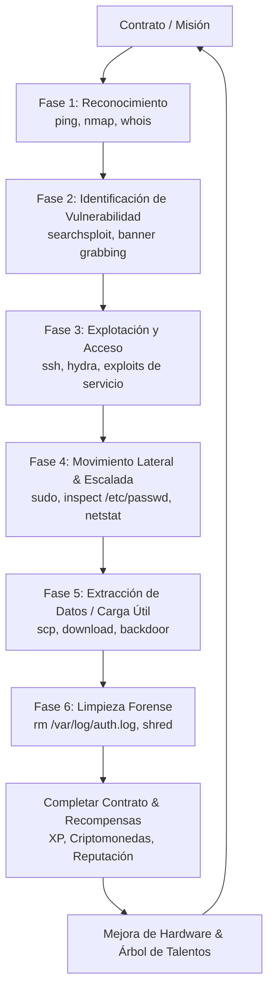
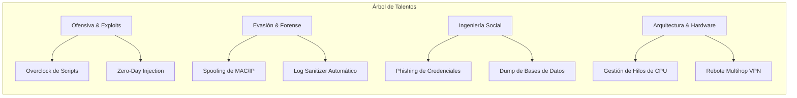
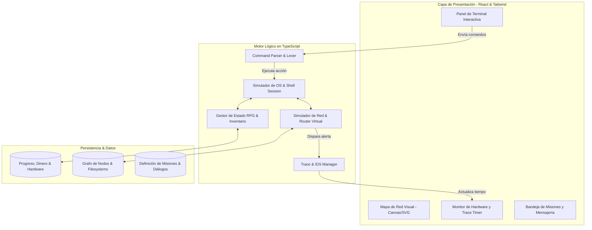

# 🌐 HackHub: Terminal Protocol (GDD & Especificación Técnica)
> **Género:** Cyberpunk Hacking Simulator / Terminal RPG  
> **Inspiraciones:** *Hacknet*, *Grey Hack*, *Uplink*, *Bitburner*, *Deus Ex*  
> **Plataforma Objetivo:** Web (React + TypeScript) & Escritorio (.exe vía Tauri/Electron)

---

## 1. Visión General del Proyecto

### 1.1 Premisa
El jugador encarna a un especialista en intrusión informática que opera desde una terminal en las sombras de una red global hiperconectada. A diferencia de los juegos de hacking basados en minijuegos arcade, **HackHub** simula una **pila de red realista** (IPs, puertos, cortafuegos, demonios y sistemas de archivos Unix) combinada con **elementos profundos de RPG**: progresión de atributos, árbol de talentos, personalización y overclocking de hardware, facciones enfrentadas y contratos con ramificaciones éticas.

### 1.2 Pilares de Diseño
1. **Verosimilitud Técnica:** Los comandos (`nmap`, `ssh`, `cat`, `grep`, `hydra`, `rm`, `ping`, `chmod`) siguen la sintaxis, flags y filosofía Unix real.
2. **Sensación Táctica y Tensión:** El sistema de rastreo (*Trace / IDS*) impone una presión de tiempo real donde cometer un error tipográfico o no limpiar los logs del sistema objetivo tiene consecuencias directas.
3. **Rol y Progresión Profunda:** Tu ordenador es tu personaje: actualiza CPUs, memoria RAM, interfaces de red y servidores proxy, mientras desbloqueas habilidades en ofensiva, evasión e ingeniería social.
4. **Narrativa No Lineal:** Las decisiones sobre qué hacer con los datos exfiltrados (venderlos al mejor postor, entregarlos a periodistas o devolverlos a la víctima) modifican tu reputación con las tres grandes facciones.



---

## 2. Mecánicas de Juego y Sistemas RPG

### 2.1 Atributos del Jugador y Árbol de Habilidades

El jugador acumula **Puntos de Experiencia (XP)** al penetrar máquinas, encontrar secretos y resolver contratos. Al subir de nivel, invierte puntos en cuatro ramas principales:



| Rama | Descripción | Efecto Jugable |
| :--- | :--- | :--- |
| **Ofensiva (Red Team)** | Especialización en exploits, desbordamiento de búfer y fuerza bruta. | Reduce el tiempo de ataque de `hydra`, desbloquea exploits para versiones más seguras de servicios. |
| **Evasión (Stealth)** | Habilidad para pasar desapercibido ante cortafuegos e IDS. | Ralentiza la barra de rastreo (*Trace Timer*), reduce el tamaño de las firmas en los logs de la víctima. |
| **Ingeniería Social (OSINT)** | Búsqueda de pistas humanas: contraseñas débiles, notas olvidadas, empleados vulnerables. | Permite acceder a cuentas secundarias sin lanzar exploits ruidosos mediante diccionarios personalizados. |
| **Criptografía / Forense** | Desencriptación de hashes (`john`/`hashcat`), análisis de paquetes. | Aumenta la velocidad para romper claves complejas (MD5, SHA-256, bcrypt). |

---

### 2.2 Sistema de Hardware y Taller (*The Rig*)

Tu máquina local consume recursos dinámicos. Las herramientas requieren potencia de cálculo:

* **CPU (Cores & GHz):** Controla la velocidad de ejecución de tareas de fuerza bruta (`hydra`), escaneo intensivo y cracking.
* **Memoria RAM (MB/GB):** Cada proceso en segundo plano (escaneos activos, túneles SSH, descargas de bases de datos) ocupa bloques de memoria. Si te quedas sin RAM, tu sistema se ralentiza o cuelga.
* **Tarjeta de Red (NIC & Wi-Fi):** Determina el ancho de banda para transferencias masivas y la capacidad de inyectar paquetes.
* **Nodos Proxy / VPNs:** Servidores que puedes alquilar en la Darknet para rebotar tu conexión. Cada salto adicional suma segundos críticos al tiempo que tarda la víctima en rastrear tu IP física.

---

### 2.3 Facciones y Reputación

| Facción | Alineamiento | Tipo de Misiones | Recompensas Típicas |
| :--- | :--- | :--- | :--- |
| **CypherSec Corp** | White Hat / Defensivo | Auditorías autorizadas, análisis forense, contramedidas contra intrusos. | Herramientas oficiales de análisis, hardware de última generación, pagos estables. |
| **Ghost Protocol** | Hacktivista / Caótico | Filtración de correos corporativos, destapar escándalos, neutralizar sistemas opresivos. | Exploits comunitarios, software modular, lealtad en foros clandestinos. |
| **Onyx Syndicate** | Black Hat / Ilegal | Desvío de criptomonedas, ransomware, espionaje industrial agresivo. | Enormes sumas de dinero sucio, acceso al mercado negro de Zero-Days. |

---

## 3. Simulación de Red y Comandos de Terminal

### 3.1 Pila de Comandos Soportada

El juego implementa un intérprete estilo Bash con soporte para autocompletado (`Tab`), historial (`↑`/`↓`), tuberías simples (`grep`) y flags realistas.

#### 📡 Red y Reconocimiento
* `ping <ip>`: Prueba conectividad y mide latencia.
* `nmap [flags] <ip>`:
  * `nmap <ip>`: Escaneo rápido de puertos estándar.
  * `nmap -sV <ip>`: Identifica versiones exactas de servicios en ejecución.
  * `nmap -p 1-1000 <ip>`: Escaneo de rango de puertos.
* `traceroute <ip>`: Muestra los saltos entre routers hasta llegar al objetivo.
* `whois <dominio>`: Información de registro, contactos administrativos y posibles correos.

#### 🔓 Intrusión y Explotación
* `ssh <usuario>@<ip> [-p puerto]`: Abre sesión remota si se tienen credenciales.
* `hydra -l <usuario> -P <diccionario> <ip> <servicio>`: Ataque de fuerza bruta automatizado.
* `searchsploit <nombre_servicio> <version>`: Consulta la base de datos de vulnerabilidades conocidas.
* `exploit -t <ip> -p <puerto> -v <vuln_id>`: Lanza un exploit contra un servicio vulnerable para obtener una shell de acceso o root.

#### 📁 Gestión de Ficheros y Sistema
* `ls [-la] [directorio]`: Lista ficheros y permisos Unix (`rwxr-xr-x`).
* `cd <directorio>`: Navegación de carpetas.
* `cat <fichero>`: Muestra el contenido de un archivo (códigos fuente, contraseñas, notas).
* `grep "<texto>" <fichero>`: Filtra líneas que coincidan con la búsqueda.
* `rm [-rf] <fichero>`: Elimina archivos (crucial para borrar registros).
* `scp <origen> <destino>`: Copia remota de archivos entre tu máquina y el objetivo.
* `ps` / `kill <pid>`: Lista y termina procesos activos.

#### 🛡️ Evasión y Limpieza Forense
* `cat /var/log/auth.log`: Inspecciona los accesos registrados de tu propia IP.
* `shred -u <archivo_log>`: Destruye el archivo de registro sin dejar rastro recuperable.
* `disconnect` / `exit`: Cierra la conexión remota inmediatamente.

#### 💻 Comandos del Sistema RPG & Meta
* `status` / `stats`: Muestra nivel actual, XP, atributos y dinero disponible.
* `hardware`: Inspecciona el estado de la CPU, uso de RAM y almacenamiento del jugador.
* `darknet`: Accede a la tienda clandestina de exploits, diccionarios y componentes de PC.
* `mail`: Cliente de correo para aceptar contratos y recibir mensajes cifrados.

---

### 3.2 Mecánica de Rastreo Activo (*The Trace Engine*)

Al ejecutar acciones ruidosas (como un `nmap` sin sigilo, ataques de fuerza bruta con `hydra` o ejecución de exploits), el **Sistema de Detección de Intrusos (IDS)** del nodo objetivo se activa:

```
[!] ADVERTENCIA: INTRUSIÓN DETECTADA POR EL FIREWALL
[!] RASTREO ACTIVO INICIADO: 192.168.1.10 -> 84.120.45.12
[!] TIEMPO RESTANTE ANTES DE RASTREO TOTAL: 01:42 min
```

1. **Rastreo Pasivo:** Conectarse pacíficamente deja un log en `/var/log/auth.log`. Si no se borra antes de desconectarse, el administrador revisa los logs pasadas unas horas de juego, aumentando tu nivel de búsqueda.
2. **Rastreo Activo:** Un temporizador en pantalla corre hacia atrás. Si llega a cero:
   * Tu conexión es forzosamente abortada.
   * Se inicia un contraataque a tu máquina (intento de formateo o desconexión).
   * Pierdes reputación y recibes una penalización económica o de tiempo.

---

## 4. Arquitectura del Software

### 4.1 Diagrama de Arquitectura Modular



### 4.2 Modelo de Datos Principal (TypeScript)

```typescript
// Estructura de un Nodo de Red en el Mundo
export interface NetworkNode {
  id: string;
  ip: string;
  hostname: string;
  organization: string;
  isPlayer: boolean;
  discovered: boolean;
  compromised: boolean;
  rootAccess: boolean;
  securityLevel: number; // 1 (Fácil) a 5 (Militar/Bancario)
  
  // Servicios expuestos
  ports: {
    port: number;
    service: 'ssh' | 'ftp' | 'http' | 'smtp' | 'sql';
    version: string;
    isOpen: boolean;
    vulnerabilityId?: string; // ID del exploit que lo compromete
  }[];

  // Sistema de archivos simulado
  fileSystem: VirtualFileSystem;
  
  // IDS & Rastreo
  hasIDS: boolean;
  traceSpeedMultiplier: number;
}

// Estado del Jugador (RPG)
export interface PlayerProfile {
  handle: string;
  level: number;
  xp: number;
  cryptoBalance: number;
  reputation: {
    cypherSec: number;
    ghostProtocol: number;
    onyxSyndicate: number;
  };
  attributes: {
    offensive: number;
    evasion: number;
    social: number;
    crypto: number;
  };
  rig: {
    cpuCores: number;
    ramTotalMb: number;
    storageTotalGb: number;
    activeProxies: string[];
  };
}
```

---

## 5. Diseño de Interfaz de Usuario (UI/UX)

La pantalla se distribuye en una estética inspirada en terminales tácticas de ciberdefensa:

```
+-------------------------------------------------------------------------------+
| HACKHUB OS v1.0.4  | CPU: [||||||    ] 38% | RAM: 1.2/4GB | PROXIES: 2 HOPS   |
+------------------------------------+------------------------------------------+
|                                    |                                          |
|  [TERMINAL INTERACTIVA]            |  [MAPA DE TOPOLOGÍA DE RED]              |
|                                    |                                          |
|  root@kali:~# nmap -sV 10.0.4.12   |       (Localhost)                        |
|  Starting Nmap 7.92...             |            │                             |
|  PORT   STATE SERVICE VERSION      |       [Proxy-01]                         |
|  21/tcp open  ftp     vsftpd 2.3.4 |            │                             |
|  22/tcp open  ssh     OpenSSH 6.6p1|       [10.0.4.12: FTP Target]            |
|  80/tcp open  http    Apache 2.4.7 |            │ (Oculto)                    |
|                                    |       [10.0.4.254: Core DB]              |
|  root@kali:~# exploit -t 10.0.4.12 |                                          |
|  [*] Payload enviado...            +------------------------------------------+
|  [+] Shell obtenida como root!     |  [ESTADO DE ALERTA / TRACE]              |
|                                    |  IDS ACTIVO: [||||||||||||||||] 62s      |
|  root@target:/# _                  |  OBJETIVO: Eliminar /var/log/vsftpd.log  |
+------------------------------------+------------------------------------------+
```

---

## 6. Hoja de Ruta de Implementación (Roadmap)

### Fase 1: Motor Base & Prototipo Jugable (MVP)
* [ ] Configuración del proyecto con **Vite + React + TypeScript + Tailwind**.
* [ ] Motor de terminal con historial, cursor parpadeante, colores ANSI y `Tab` autocompletado.
* [ ] Sistema de archivos virtual (`ls`, `cd`, `cat`, `rm`, `mkdir`).
* [ ] Red básica con 3 nodos de prueba (Tu PC, Servidor Web local, Servidor FTP vulnerable).

### Fase 2: Simulación de Ataques & Evasión
* [ ] Implementación de `nmap`, `ping`, `ssh` y `hydra`.
* [ ] Sistema de vulnerabilidades por versión de servicio.
* [ ] Temporizador de rastreo activo (*Trace System*) y archivos de log auditables.
* [ ] Mapa visual de red renderizado con Canvas/SVG interactivo.

### Fase 3: Capa RPG & Narrativa
* [ ] Árbol de habilidades y subida de nivel por XP.
* [ ] Sistema de contratos/misiones con entregas y objetivos específicos.
* [ ] Tienda de la Darknet para compra de hardware y diccionarios de contraseñas.
* [ ] Sistema de correo electrónico cifrado con adjuntos.

### Fase 4: Pulido Audiovisual & Empaquetado
* [ ] Efectos visuales CRT, scanlines y aberration cromática opcional.
* [ ] Efectos sonoros mecánicos (tecleo, zumbido de discos, sirena de alarma de intrusión).
* [ ] Empaquetado con **Tauri** para generar el instalador de escritorio de Windows (`.exe`).
